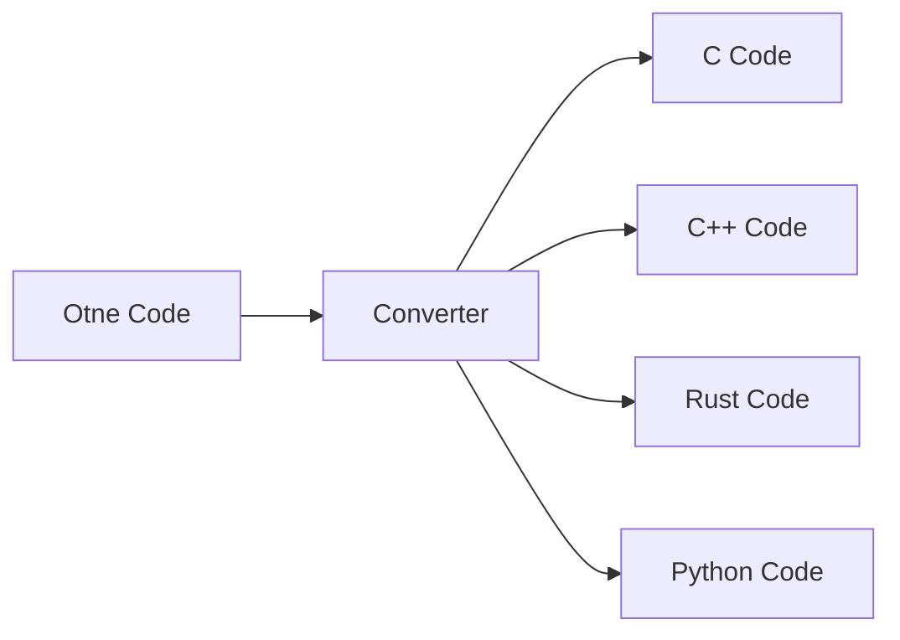

# 更新日志

本文件记录 Otne 的重要变更。

## [未发布]

### 新增

- 新增 `docs/otne.bnf`：完整 BNF 语法定义，包含词法规则、关键字表与运算符优先级

### 变更

- 移除 `fn` 关键字，函数定义统一使用 `func`

## [0.2.0] 2026-10-31

完整重写为可执行程序的语言实现。

### 新增

- **词法分析器**：关键字、标识符、数字、字符串、运算符、行注释与块注释，输出带行/列信息的 Token
- **语法分析器**：递归下降实现，构建 AST，支持 `if` / `elif` / `else`、`while`、C 风格 `for`、`break` / `continue` / `return`
- **解释器**：树遍历求值，支持 `int` / `float` / `string` / `bool` / `null`、函数定义与递归、闭包作用域、短路逻辑运算
- **类型标注**：变量、参数、返回值可声明 `int` / `float` / `string` / `bool` / `any`，运行时检查
- **内建函数**：`print` / `println` / `printf` / `str` / `int` / `float` / `len` / `type`
- **构建工具**：新增根目录 `Makefile`，`make` / `run` / `tokens` / `test` / `ctest` / `rebuild` / `clean` / `help`；CMake 接入 CTest

### 变更

- 语法重新设计：顶层只允许 `import` 与 `fn` 定义，语句必须位于函数体内；入口函数为 `main`
- 关键字与标识符仅支持 ASCII 字母、数字与下划线，不支持中文关键字/中文标识符；中文只可用于字符串与注释
- CLI 支持 `-h` / `-v` / `-t`，可指定源文件
- 错误输出统一为 `error: 文件:行:列: 消息`
- 项目结构拆分：`token` / `lexer` / `ast` / `parser` / `value` / `interpreter` / `diagnostic` 分层
- 移除 `otne/src/otne.cpp`、`otne.hpp` 两个空占位文件

### 修复

- 源码与输出统一按 UTF-8 处理，中文内容不再因 locale 缺失而输出为空
- 源文件读取不再依赖 MSVC 专有的 `fopen("rt+,ccs=UTF-8")`

### 示例

- 新增 `HelloUniverse.otne`、`Fibonacci.otne`、`FizzBuzz.otne`、`Types.otne`
- `HelloWorld.otne` 改为可运行的最小程序

## [0.1.0] 2026-10-31

### 变更

- 项目整理：统一目录结构、CMake 构建、文档与示例归档
- 词法扫描器：逐个输出扫描到的 Token（仅调试用途）

## [0.0.2-alpha] 计划中

- [ ] Converter：支持转换为 C、C++、Rust、Python
- [ ] 列表 / 字典等复合类型
- [ ] 标准库模块

## [0.0.1-alpha]

- [x] Interpreter（解释器）
- [ ] Compiler（编译器）
